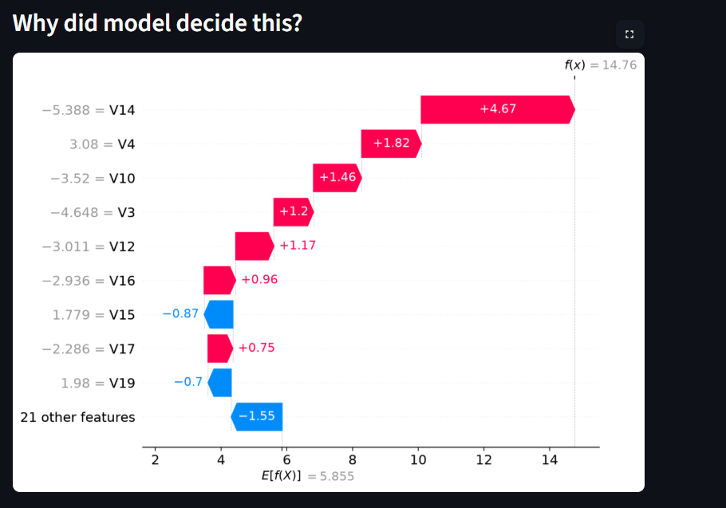
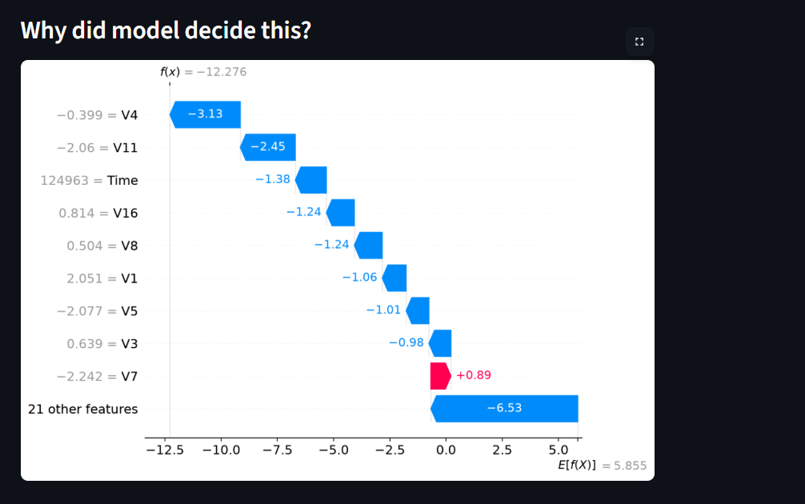

# 💳 Credit Card Fraud Detection

**Live demo:** https://fraud-detector-rohit.streamlit.app

An end-to-end machine learning project that detects fraudulent credit card
transactions and explains every prediction using SHAP.

## Problem
Banks process millions of transactions, and only a tiny fraction are fraud.
Missing a fraud costs money; wrongly blocking a genuine customer costs trust.
The goal: catch as many frauds as possible with few false alarms.

## Dataset
Kaggle "Credit Card Fraud Detection" (ULB): 284,807 transactions, only 492
frauds (0.17%). Features V1–V28 are PCA-transformed for privacy.

## Approach
1. **EDA**: extreme class imbalance, skewed `Amount`, scaling needed
2. **Stratified split** (80/20) so train and test keep the same fraud ratio
3. **Baseline**: Logistic Regression (accuracy was 99.9%, but misleading)
4. **Imbalance handling**: class weights and SMOTE (applied on train only)
5. **XGBoost** with `scale_pos_weight`
6. **Optuna** hyperparameter tuning with 3-fold stratified CV
7. **Threshold tuning** using out-of-fold predictions (no test leakage)
8. **SHAP** for global and per-transaction explanations
9. **Streamlit app**, deployed on Streamlit Community Cloud

## Results (test set, 98 frauds)

| Model | Precision | Recall | PR-AUC |
|---|---|---|---|
| Logistic Regression (baseline) | 0.829 | 0.643 | 0.739 |
| + Class weights | 0.061 | 0.918 | 0.717 |
| + SMOTE | 0.059 | 0.918 | 0.725 |
| XGBoost | 0.872 | 0.837 | 0.876 |
| XGBoost + Optuna | 0.844 | 0.827 | 0.874 |
| XGBoost + Optuna + threshold (0.77) | 0.889 | 0.816 | 0.874 |

## Key learnings
- **Accuracy is useless here**: a model predicting "normal" for everything
  scores 99.83% accuracy while catching zero fraud. I used Precision,
  Recall and PR-AUC instead.
- Class weights and SMOTE raised recall but crashed precision for a linear
  model. XGBoost improved the actual ranking quality (PR-AUC).
- - Optuna did not improve test PR-AUC (0.876 before, 0.874 after). The default
  XGBoost was already strong, and with only 98 frauds in the test set, such a
  small difference is noise.
- The decision threshold was chosen on out-of-fold train predictions, never on
  the test set, to avoid data leakage.
- SHAP showed V14, V4, V12 and V10 drive most fraud predictions, which matched
  the correlation seen in EDA.

## Screenshots



## Run locally
```bash
pip install -r requirements.txt
streamlit run app.py
```

## Tech stack
Python, pandas, scikit-learn, XGBoost, imbalanced-learn, Optuna, SHAP, Streamlit
